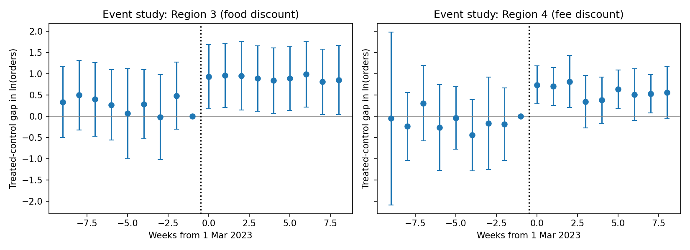
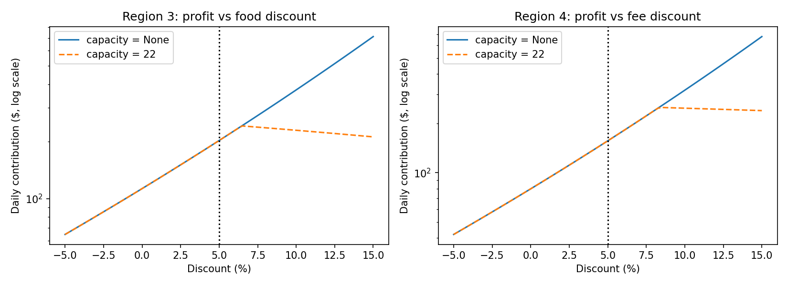

# PizzaHub Pricing Optimisation
### Causal Elasticity Estimation & Profit Optimisation

Estimating price elasticities using a simulated natural experiment, then identifying profit-maximising discounts for a pizza delivery business.

> **Data note:** This is a synthetic dataset with region-specific order means and volatilities. Results describe a simulated business, not actual commercial performance.

## Problem

PizzaHub sells a $16 pizza with a $4 variable cost across four regions. On 1 March 2023, it introduced:

- **Region 3:** 5% food price discount
- **Region 4:** 5% delivery fee discount
- **Regions 1 and 2:** No price changes (control regions)

The analysis investigates two questions:

1. How sensitive is demand to changes in food prices and delivery fees?
2. What discount level maximises contribution profit?

## Approach

1. **Exploratory analysis:** Compared pre- and post-policy order volumes and weekly trends across regions.
2. **Difference-in-differences:** Estimated treatment effects on log daily orders using HC3 robust standard errors. Converted the estimates into price elasticities and used Poisson DiD as a robustness check.
3. **Validity checks:** Assessed parallel pre-trends, placebo policy dates and weekly event-study effects.
4. **Profit optimisation:** Applied the Inverse Elasticity Rule (IER), followed by a constrained search using constant-elasticity demand, a ±15% price-change range and a daily capacity ceiling of 22 orders.

## Results

### Price elasticity estimates

| Metric | Food discount (R3) | Delivery discount (R4) |
|---|---:|---:|
| Raw change in average daily orders | +66% | +49% |
| DiD effect on log orders (SE) | 0.652 (0.088) | 0.706 (0.138) |
| Implied change in orders | ~+92% | ~+103% |
| **Log-DiD elasticity** | **-12.7** | **-13.8** |
| 95% confidence interval | [-16.1, -9.4] | [-19.0, -8.5] |
| Poisson DiD elasticity | -10.5 | -8.4 |
| Pre-trend p-value | 0.236 | 0.950 |
| Placebo DiD p-value | 0.471 | 0.578 |

### Constrained profit optimisation

The unconstrained IER produces impractical prices ($4.34 for food and -$4.85 for the delivery fee), highlighting the need for operational constraints.

With a capacity ceiling of 22 orders/day:

| Metric | Food discount (R3) | Delivery discount (R4) |
|---|---:|---:|
| **Optimal discount** | **6.6%** | **8.4%** |
| Optimal discount across elasticity CI | 5.2%–8.8% | 6.2%–13.2% |
| Profit/day: no discount | $112.88 | $79.73 |
| Profit/day: current 5% discount | $202.14 | $156.49 |
| **Profit/day: optimal discount** | **$240.77** | **$250.14** |

*Profit figures represent model-implied contribution margins, not observed profits or net profit. Fixed costs of approximately $13.70/day are assumed constant.*

### Visualisations





## Key Takeaways

- Both discounts increased order volumes, with no statistically significant pre-trend differences or placebo effects detected.
- Estimated elasticities are unusually large (-12.7 and -13.8), likely reflecting the synthetic data-generating process. The magnitudes should not be interpreted as reliable real-world demand estimates.
- Unconstrained optimisation produces unrealistic prices. Applying a capacity ceiling gives more practical discount recommendations, close to the tested 5% level.
- Optimal discounts vary with capacity assumptions. Across 16–30 orders/day, the food discount ranges from 4.2% to 8.8%, and the delivery discount from 6.2% to 10.4%.

**Recommendation:** Test multiple discount levels (0%, 5%, 10% and 15%) through a randomised experiment before scaling either promotion.

## Reproduce

```bash
pip install -r requirements.txt
python src/run_analysis.py
```

Alternatively, run the notebooks in order:

1. `01_eda.ipynb`
2. `02_did_elasticity.ipynb`
3. `03_profit_optimisation.ipynb`
